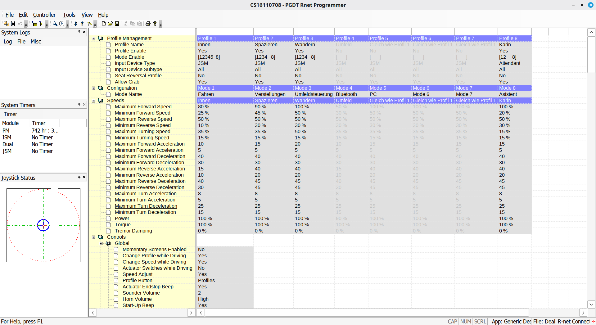
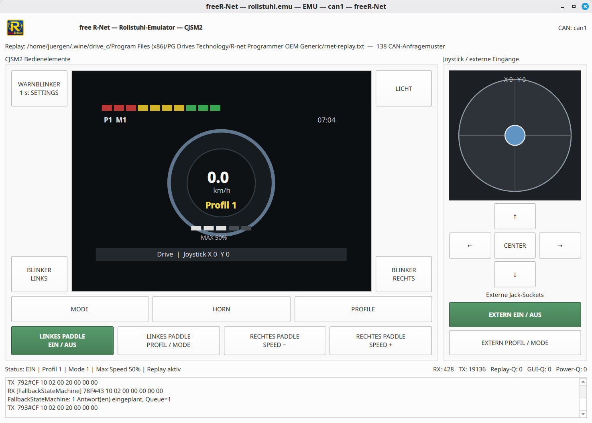
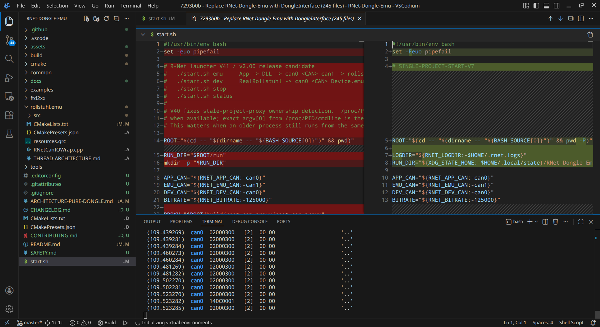
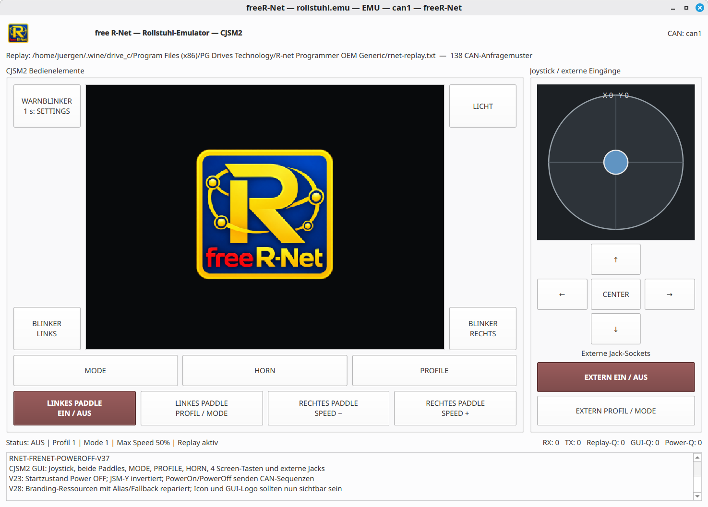
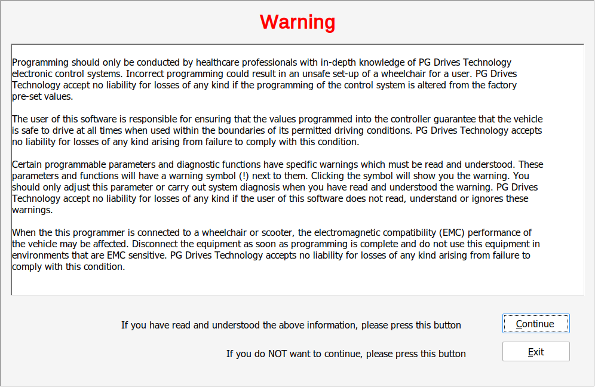

<p align="center">
  
</p>

<h1 align="center">freeR-Net</h1>

<p align="center">
  <strong>R-Net dongle interface, SocketCAN bridge and wheelchair emulator research toolkit.</strong>
</p>

<p align="center">
  <a href="https://github.com/notwendig/RNet-Dongle-Emu/actions/workflows/build.yml"></a>
  
  
  
  
  
</p>

---

**freeR-Net** is an engineering and protocol-research project for understanding the
R-Net programmer/dongle communication path and for testing R-Net protocol behaviour
against an emulated wheelchair endpoint.

The repository deliberately separates the **dongle/transport layer** from the
**wheelchair protocol/state-machine layer**.

> [!CAUTION]
> This is research software, not a safety-certified mobility control system.
> The repository intentionally does **not** provide instructions for binding a real
> wheelchair CAN interface or switching a dealer dongle to OEM mode. See
> [SAFETY.md](SAFETY.md).

## Architecture

```text
R-Net Programmer OEM
        │
        │ FTD2XX / Raw24
        ▼
   ftd2xx.dll
  DongleInterface
        │
        │ SocketCAN / proxy
        ▼
      can0
        │
        │ test CAN pair
        ▼
      can1
        │
        ▼
 rollstuhl.emu
```

The protocol boundary is intentional:

- `ftd2xx/` handles FTDI-facing transport, framing and CAN transport.
- `common/` contains the shared recovered message types (`CRawMsg`, `CCANMsg`,
  `CPOPMsg`, stream helpers).
- `tools/rnet-can-proxy/` bridges the DLL transport to SocketCAN and implements the
  sticky Power-Off TX gate.
- `rollstuhl.emu/` owns wheelchair-side POP/block/session/power state machines.
- `start.sh` is the single public entry point.

See [ARCHITECTURE-PURE-DONGLE.md](ARCHITECTURE-PURE-DONGLE.md) for the detailed data path.

## Current status

| Area | Status |
|---|---|
| Programmer connection | Working in emulation tests |
| Configuration read | Working |
| Configuration write | Working for the implemented POP/write path |
| Segmented POP write | Implemented on `rollstuhl.emu` side |
| Manual Power-On | Required; automatic re-wake is blocked |
| Power-Off | Sticky CAN-TX silence after final Power-Off |
| Real CAN verification | Configuration read verified on a You-Q test chair |
| Runtime logs | Timestamped under `~/.rnet.logs/` |
| CAN trace | `candump -tz -ca can0` per run |

## Quick start

The supported public commands are:

```bash
./start.sh emu
./start.sh real
./start.sh status
./start.sh stop
```

`emu` and `real` always perform a fresh run:

```text
reset
→ stop old project processes
→ rm -rf build
→ rebuild all components
→ deploy runtime
→ start timestamped candump
→ start selected mode
```

### `emu`

```text
App → DLL → can0 ⇄ can1 → rollstuhl.emu
```

The Programmer, DLL transport, proxy and wheelchair emulator are started together.

### `real`

```text
Real wheelchair → can0 → Device.emu_CJSM
```

`real` is the public command name. Internally the existing GUI/device mode still uses
the `dev` argument.

## Logs

All runtime logs stay outside the repository:

```text
~/.rnet.logs/
```

Typical files:

```text
YYYYMMDD-HHMMSS-candump.log
YYYYMMDD-HHMMSS-rnet-can-proxy.log
YYYYMMDD-HHMMSS-rollstuhl.emu.log
YYYYMMDD-HHMMSS-programmer.log
YYYYMMDD-HHMMSS-ftd2xx-emu.log
```

Existing logs are never deleted or overwritten by `start.sh`.

## Build requirements

The project is developed and tested primarily on Linux with:

- CMake + Ninja
- GCC/G++
- MinGW-w64 i686 cross compiler
- Qt 6 Widgets
- SocketCAN / `can-utils`
- Wine/Wine-staging for the 32-bit R-Net Programmer

The root CMake preset builds the 32-bit Windows `ftd2xx.dll`.
`rollstuhl.emu` and `rnet-can-proxy` are native Linux binaries.

## Repository layout

```text
.
├── assets/branding/          freeR-Net logos and application icons
├── cmake/toolchains/         MinGW32 cross toolchain
├── common/                   shared R-Net/Dongle message classes
├── docs/                     project and GitHub documentation
├── examples/                 runtime configuration example
├── ftd2xx/                   Windows FTD2XX/DongleInterface implementation
├── rollstuhl.emu/            Qt6 wheelchair/device emulator
├── tools/rnet-can-proxy/     native SocketCAN transport proxy
├── .github/                  CI, issue forms and PR template
└── start.sh                  emu | real | stop | status
```

## Branding

The Qt application uses the embedded freeR-Net icons from
`rollstuhl.emu/resources.qrc`. Repository assets are in
[`assets/branding/`](assets/branding/).

For the GitHub repository social preview, use:

```text
assets/branding/free-r-net-logo-1254.png
```

See [docs/GITHUB-SETUP.md](docs/GITHUB-SETUP.md).

<!-- FREER_NET_SCREENSHOTS_V9 -->
## Screenshots

The following screenshots show the current **freeR-Net** user interface, the
original PGDT programmer view under Wine, and the repository/build workspace.

### PGDT R-Net Programmer

<p align="center">
  
</p>

### freeR-Net emulator — active replay / runtime

<p align="center">
  
</p>

### freeR-Net repository / start.sh comparison in VSCodium

<p align="center">
  
</p>

### freeR-Net emulator — branded idle / power-off screen

<p align="center">
  
</p>

### PGDT Programmer warning dialog

<p align="center">
  
</p>

> [!NOTE]
> These screenshots were captured from the current Linux/Wine-based development
> environment and illustrate the public project branding, application windows
> and runtime behaviour.
## Safety boundaries

The repository contains protocol research and emulation code. Real-hardware use must
be treated separately from bench/emulation testing.

Important project rules include:

- after the first Power-Off request, DLL→CAN TX stays silent for that proxy session;
- `0x00C` must not automatically re-enable TX after Power-Off;
- wheelchair protocol responses belong in `rollstuhl.emu`, not in the FTD layer;
- real-chair CAN binding and dealer→OEM conversion are intentionally outside this repo.

Read [SAFETY.md](SAFETY.md) before using the project with physical hardware.

## Contributing

Contributions are welcome when they preserve the transport/protocol separation and
include enough logs or captures to reproduce protocol changes.

See [CONTRIBUTING.md](CONTRIBUTING.md).

## Acknowledgements

Special thanks to **Constantin Grosch** for donating the R-Net programmer dongle that
made this research possible.

Thanks also to **ChatGPT by OpenAI** for assistance with reverse engineering,
protocol analysis, build tooling and documentation.

---

<p align="center">
  <br>
  <strong>freeR-Net</strong> — protocol research with a strict transport/state-machine boundary.
</p>
